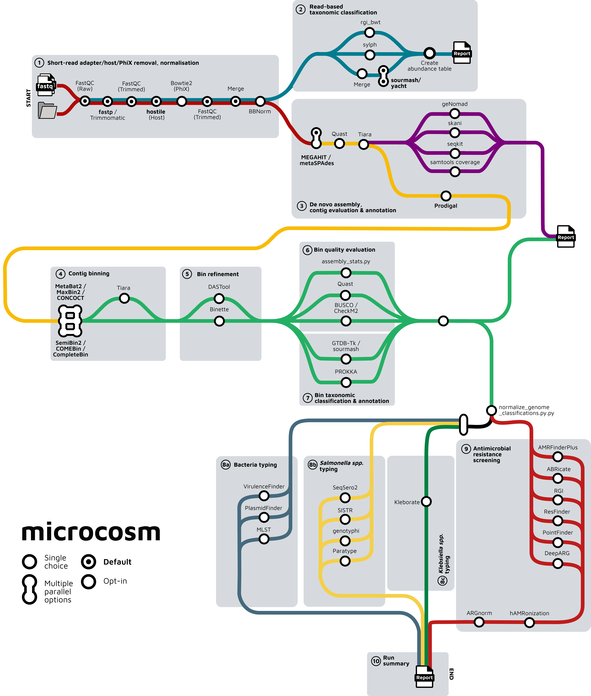

<div align="center">


### Short-read metagenomics, from reads to typed bacterial genomes

[](https://www.nextflow.io/)
[](https://docs.conda.io/en/latest/)
[](https://www.docker.com/)
[](https://apptainer.org/)
[](https://sylabs.io/docs/)
[](https://www.schedmd.com)

<p>
<a href="https://github.com/tnmquann/microcosm/wiki/Quick-start"><b>Quick start</b></a> ·
<a href="https://github.com/tnmquann/microcosm/wiki"><b>Documentation</b></a> ·
<a href="https://github.com/tnmquann/microcosm/wiki/microcosm-cookbook"><b>Cookbook</b></a> ·
<a href="https://github.com/tnmquann/microcosm/releases/tag/2.0.0"><b>Release notes</b></a> ·
<a href="https://github.com/tnmquann/microcosm/issues"><b>Report an issue</b></a>
</p>

</div>

---

**microcosm** (formerly **metaflow**) is a modular [Nextflow](https://www.nextflow.io/) pipeline for Illumina
short-read shotgun metagenomes. It combines fast read-based profiling, genome-resolved analysis and a bacterial
typing / AMR layer, and summarises every run in one MultiQC report. It is built for molecular epidemiology
(outbreak investigation, surveillance) and tuned to run on modest hardware. The design follows the concepts of
[nf-core/mag](https://nf-co.re/mag/latest/) and [SOMA](https://github.com/ukhsa-collaboration/SOMA).

> [!NOTE]
> **microcosm 2.0.0** is the first release under the new name and needs **Nextflow ≥ 26.04**.
> Coming from metaflow 1.x? Read [Upgrading from metaflow 1.x](#upgrading-from-metaflow-1x).

<table>
<tr>
<td width="50%" valign="top">

#### Read-based profiling
- **sourmash + YACHT** (default) or **sylph** (+ sylph-tax), or both
- AMR genes on reads with **RGI bwt**
- Ready-to-use **phyloseq** and **taxburst** tables

</td>
<td width="50%" valign="top">

#### Genome-resolved metagenomics
- **MEGAHIT / metaSPAdes**, contig analysis (geNomad, Tiara, skani)
- Six binners, **Binette / DAS Tool** refinement
- **CheckM2, CheckM, BUSCO, GUNC**; sourmash or **GTDB-Tk**

</td>
</tr>
<tr>
<td width="50%" valign="top">

#### Bacterial genome analysis
- MLST, VirulenceFinder, PlasmidFinder
- **AMRFinderPlus, ABRicate, RGI, ResFinder, DeepARG** → hAMRonization + ARGnorm
- **Kleborate** for *Klebsiella*/*E. coli*; **SISTR, SeqSero2, GenoTyphi, Paratype** for *Salmonella*

</td>
<td width="50%" valign="top">

#### One report per run
- **MultiQC** report from read QC to typed genomes
- One file with every tool version
- Run summary of the parameters you changed

</td>
</tr>
</table>

<p align="center">
  
</p>

## Contents

<table>
<tr>
<td valign="top">

**Get started**
- [Pipeline at a glance](#pipeline-at-a-glance)
- [Requirements](#requirements-and-installation)
- [Inputs](#input-specifications)
- [Quick start](#quick-start)

</td>
<td valign="top">

**Analyses**
- [Read-based analysis](#read-based-analysis)
- [Assembly-based analysis](#assembly-based-analysis)
- [Bacterial genome analysis](#bacterial-genome-analysis)
- [MultiQC report](#multiqc-report)

</td>
<td valign="top">

**Reference**
- [Output structure](#output-structure)
- [Upgrading from metaflow 1.x](#upgrading-from-metaflow-1x)
- [Citation](#citation)
- [Full documentation (wiki)](https://github.com/tnmquann/microcosm/wiki)

</td>
</tr>
</table>

## Pipeline at a glance

| Stage | Tools | Turned on by |
|:---|:---|:---|
| **Read QC and host removal** | FastQC, fastp, hostile | always (`--skip_preprocess` to skip) |
| **Read-based profiling** | sourmash + YACHT (`microcosm`), sylph (+ sylph-tax) | `--enable_readbase`, `--readbased_taxotools` |
| **Read-based post-processing** | standard table, phyloseq, taxburst | `--readbased_postprocess` |
| **Read-based AMR genes** | RGI bwt (CARD) | `--enable_rgi_bwt` |
| **Assembly** | MEGAHIT, metaSPAdes, QUAST | default route (no `--enable_readbase`) |
| **Read mapping** | Bowtie2 or BWA-MEM2, once per assembly | `--binprepare_mappertool` |
| **Contig analysis** | SeqKit, samtools coverage, Pyrodigal / Prokka, geNomad, Tiara, skani | default (each step can be skipped) |
| **Binning and refinement** | MetaBAT2, MaxBin2, COMEBin, SemiBin2, CONCOCT, VAMB; Binette / DAS Tool | default |
| **Bin QC** | CheckM2, CheckM, BUSCO, GUNC, QUAST, `assembly_stats.py`, Tiara | `--binqc_tool`, `--run_gunc`, `--bin_domain_classification` |
| **Bin annotation and taxonomy** | Prokka / Bakta; sourmash / GTDB-Tk | `--bin_annotation_tool`, `--bin_classifier` |
| **Bacterial genome analysis** | typing, AMR, *Klebsiella*, *Salmonella* | `--enable_bacterial_downstream` or `--genome_input` |
| **Report** | MultiQC, software versions, run summary | always (`--skip_multiqc` to skip) |

## Requirements and installation

| | |
|:---|:---|
| **Workflow engine** | Nextflow **≥ 26.04.0** (strict syntax), Java 17+ |
| **Software** | one profile: `singularity`, `apptainer`, `docker` or `conda`; add `gpu` (e.g. `docker,gpu`) for COMEBin / SemiBin2 on GPU |
| **System** | Linux or macOS (Windows through WSL) |
| **Memory** | 32 GB for MEGAHIT; up to 128 GB for metaSPAdes and GTDB-Tk |
| **Disk** | ≥ 256 GB for databases, environments and work files |

```bash
nextflow pull tnmquann/microcosm -r 2.0.0
nextflow run tnmquann/microcosm -r 2.0.0 --help
```

| Database | Who gets it |
|:---|:---|
| sourmash + lineages, YACHT, sylph, skani, GTDB-Tk | **you** ([how](https://github.com/tnmquann/microcosm/wiki/Installation#database-preparation)) |
| hostile, CARD, geNomad, CheckM, CheckM2, GUNC, Bakta, AMRFinderPlus, ResFinder, DeepARG, VirulenceFinder, Paratype | **the pipeline**, when no path is given; saved to `<outdir>/Databases/` for reuse |

> [!CAUTION]
> sourmash and YACHT databases must be built with the same reference set, k-mer size and scaled value.

## Input specifications

<table>
<tr><th width="50%">Reads: <code>--input</code></th><th width="50%">Genomes: <code>--genome_input</code></th></tr>
<tr>
<td valign="top">

```csv
sample_id,run_id,group,short_reads_1,short_reads_2,long_reads
s1,1,0,data/s1_1.fq.gz,data/s1_2.fq.gz,
s2,1,0,data/s2_1.fq.gz,data/s2_2.fq.gz,
```

- CSV (`--input_format csv`, default) or a folder of paired FASTQ (`*_1/*_2` or `*_R1/*_R2`, `--input_format directory`)
- Pre-computed assemblies: `--assembly_input` (`sample_id,run_id,group,assembler,fasta`)

</td>
<td valign="top">

```csv
sample_id,fasta,lineage
kpn1,genomes/kpn1.fasta.gz,
sty1,genomes/sty1.fasta.gz,d__Bacteria;...;s__Salmonella enterica
```

- Runs **only** the bacterial genome analysis (no reads needed)
- Blank `lineage` → classified by sourmash or GTDB-Tk
- Relative paths are read from the CSV folder; example in `test_data/bacterial_genomes/`

</td>
</tr>
</table>

## Quick start

<details open>
<summary><b>Read-based profiling</b>: who is in my samples, and which AMR genes are in the reads?</summary>

```bash
nextflow run tnmquann/microcosm -r 2.0.0 -profile singularity \
    --input samples.csv --outdir project_A --enable_readbase \
    --sourmash_database /db/gtdb-rs226-reps.k31.rocksdb --sourmash_taxonomy_csv /db/gtdb-rs226.lineages.csv \
    --yacht_database /db/yacht_rs226_k31.json \
    --enable_rgi_bwt --readbased_postprocess all
```
</details>

<details>
<summary><b>Read-based profiling with sylph</b></summary>

```bash
nextflow run tnmquann/microcosm -r 2.0.0 -profile singularity \
    --input samples.csv --outdir project_A_sylph --enable_readbase --readbased_taxotools sylph \
    --sylph_database /db/gtdb-r226-c200-dbv2.syl2db \
    --enable_sylphtax --sylph_taxonomy /db/gtdb_r226_metadata.tsv.gz
```
</details>

<details>
<summary><b>Genome-resolved analysis + typing and AMR of the bacterial bins</b></summary>

```bash
nextflow run tnmquann/microcosm -r 2.0.0 -profile singularity \
    --input samples.csv --outdir project_B \
    --sourmash_database /db/gtdb-rs226-k51.rocksdb --sourmash_ksize 51 --sourmash_taxonomy_csv /db/gtdb-rs226.lineages.csv \
    --binqc_tool checkm2,busco --run_gunc --enable_bacterial_downstream
```
</details>

<details>
<summary><b>Typing and AMR of your own genome FASTA files</b> (classified with GTDB-Tk)</summary>

```bash
nextflow run tnmquann/microcosm -r 2.0.0 -profile singularity \
    --genome_input genomes.csv --outdir project_C \
    --bin_classifier gtdbtk --gtdbtk_db /db/gtdbtk/release226
```
</details>

> [!TIP]
> Add `-resume` to continue a stopped run, and `--max_cpus 16 --max_memory 64.GB` to cap the machine use.
> More recipes: [Cookbook](https://github.com/tnmquann/microcosm/wiki/microcosm-cookbook).

## Read-based analysis

### Profilers

| `--readbased_taxotools` | Runs | Outputs |
|:---|:---|:---|
| `microcosm` (default) | sourmash gather + YACHT | `Readbased_Analysis/Sourmash-YACHT/` |
| `sylph` | sylph profile per sample (paired reads, no merging) | `Readbased_Analysis/sylph/` |
| `microcosm,sylph` | both | both folders |

<details>
<summary><b>sylph options</b></summary>

| Parameter | Meaning |
|:---|:---|
| `--sylph_database` | sylph database(s) (`*.syldb` / `*.syl2db`), comma-separated for several |
| `--sylph_args` | extra `sylph profile` arguments |
| `--enable_sylphtax` | run `sylph-tax taxprof`; needs `--sylph_taxonomy` (one metadata file per database, comma-separated) |
| `--sylph_datatype` | `taxonomic_abundance` (default) or `sequence_abundance` (estimated read counts) |

With `--enable_sylphtax`, `Readbased_Analysis/sylph/` holds `profile/`, `sylphtax/*.sylphmpa`,
`<prefix>_sylphtax_<datatype>.tsv` and, with `--readbased_postprocess phyloseq|all`, `phyloseq/`.
</details>

<details>
<summary><b>Several sourmash databases, intermediate files</b></summary>

- Several databases: `--sourmash_database "db1.zip,db2.zip"` with one taxonomy each in `--sourmash_taxonomy_csv "tax1.csv,tax2.csv"`.
  Zip/sig databases can be combined, RocksDB indexes cannot. YACHT takes one database and is skipped in that case.
- `--enable_copymergedseqs`, `--enable_copysketch`, `--enable_copysketch_singles`, `--enable_copyintermediate`
  turn the publishing of merged reads, sketches and YACHT intermediate tables on or off.
- `--enable_singlesketch` processes each sample separately (microcosm branch only).
</details>

### Post-processing

| `--readbased_postprocess` | Writes to `Readbased_Analysis/Post_processing/` |
|:---|:---|
| `all` | everything below + `<prefix>_default/<prefix>.processed_microcosm.csv` |
| `phyloseq` | `<prefix>_phyloseq/{otu_table,tax_table,sample_data}.csv` |
| `taxburst` | `<prefix>_taxburst/*.taxburst.csv` |
| `rgi_bwt` | `<prefix>_rgi_bwt/` (needs `--enable_rgi_bwt`) |

- `<prefix>` is the last folder name of `--outdir`; with `--enable_singlesketch` outputs are per sample plus all-sample aggregates.
- Filters: `--readbased_postprocess_options` (default `--min_coverage 0.05`), e.g. `"--min_coverage 0.1 --use_average"`.

## Assembly-based analysis

Without `--enable_readbase`, microcosm assembles, maps, bins and characterises the genomes:

| Step | Default | Change with |
|:---|:---|:---|
| Assembly | MEGAHIT **and** metaSPAdes | `--skip_megahit`, `--skip_spades` |
| Read mapping (once, shared by contig coverage and binning) | Bowtie2 | `--binprepare_mappertool bwamem2` |
| Contig annotation | Pyrodigal | `--annotation_tool prokka` |
| Binning | MetaBAT2, MaxBin2, COMEBin, SemiBin2 | binner switches ([Parameters](https://github.com/tnmquann/microcosm/wiki/Parameters#binning-options)) |
| Refinement | Binette | `--refine_tool dastool` |
| Bin QC | CheckM2 | `--binqc_tool checkm2,checkm,busco`, `--run_gunc` |
| Bin annotation | Prokka | `--bin_annotation_tool bakta` |
| Bin classification | sourmash | `--bin_classifier gtdbtk --gtdbtk_db <R226>` |

The sorted BAM is saved once in `Binning/mapping/sorted_bam/` (`--save_assembly_mapped_reads`). Every step has a
`--skip_<step>` switch; see [Parameters](https://github.com/tnmquann/microcosm/wiki/Parameters).

## Bacterial genome analysis

Bins of an assembly run (`--enable_bacterial_downstream`) or your own genomes (`--genome_input`) go through:

```text
genome ─► lineage (given, or sourmash / GTDB-Tk) ─► d__Bacteria? ─► general typing + AMR ─► Klebsiella / Salmonella typing
                                                       └─ no ─► routing/excluded_genomes.tsv or unresolved_genomes.tsv
```

| Genome | Tools |
|:---|:---|
| **Every bacterium** | MLST, VirulenceFinder, PlasmidFinder · AMRFinderPlus (`--organism` from the lineage), ABRicate, RGI, ResFinder + PointFinder + DisinFinder, DeepARG → hAMRonization → ARGnorm |
| ***Klebsiella*, *Raoultella*, *Escherichia*** | + Kleborate v3 (`kpsc`, `kosc` or `escherichia` preset from the lineage) |
| ***Salmonella*** | + SISTR, SeqSero2; serovar **Typhi** → Mykrobe + GenoTyphi; **Paratyphi A** → Paratype |

<details>
<summary><b>Classification with GTDB-Tk</b></summary>

`--bin_classifier gtdbtk --gtdbtk_db /path/to/release226` runs GTDB-Tk 2.7.2 `classify_wf` (one call per sample,
results in `Taxonomy/GTDB-Tk/`) instead of sourmash. Its summaries are converted to the sourmash table, so routing,
decision table and MultiQC work unchanged. "Unclassified Bacteria" is routed as `d__Bacteria`; genomes GTDB-Tk cannot
place are listed as unresolved with GTDB-Tk's reason. GTDB-Tk needs 64-128 GB of memory (`--gtdbtk_pplacer_cpus`,
`--gtdbtk_pplacer_scratch`, `--gtdbtk_args`).
</details>

<details>
<summary><b>Databases</b>: all optional, downloaded and saved when not given</summary>

| Tool | Parameter | Saved to (`--save_<tool>_db`, default `true`) |
|:---|:---|:---|
| AMRFinderPlus | `--amrfinderplus_db` | `Databases/AMRFinderPlus/` |
| RGI (CARD, shared with RGI bwt) | `--rgi_preparecarddb_dir` | `Databases/RGI/` |
| ResFinder / PointFinder / DisinFinder | `--resfinder_db`, `--pointfinder_db`, `--disinfinder_db` | `Databases/ResFinder/` |
| DeepARG | `--deeparg_db` | `Databases/DeepARG/` |
| VirulenceFinder | `--virulencefinder_db` | `Databases/VirulenceFinder/` |
| Paratype | `--paratype_bundle` | `Databases/ParaType/` |
| PlasmidFinder, ABRicate, MLST, Kleborate, SISTR, SeqSero2, Mykrobe | bundled in the containers | - |

Nothing is downloaded when no bacterial genome reaches the analysis. Pinned revisions: `--resfinder_db_revision`,
`--virulencefinder_db_revision`, `--paratype_revision`.
</details>

<details>
<summary><b>Customising the steps</b></summary>

| What | How |
|:---|:---|
| Turn a tool off | `--skip_mlst`, `--skip_virulencefinder`, `--skip_plasmidfinder`, `--skip_kleborate`, `--skip_sistr`, `--skip_seqsero2`, `--skip_genotyphi`, `--skip_paratype`, `--skip_amrfinderplus`, `--skip_abricate`, `--skip_rgi`, `--skip_resfinder`, `--skip_deeparg`, `--skip_argnorm` |
| Tool options | `--<tool>_args`; defaults are part of the value: `amrfinderplus_args='--plus'`, `resfinder_args='--acquired --disinfectant'`, `rgi_main_args='--clean -g PYRODIGAL'`, `seqsero2_args='-m k -t 4'` |
| Lineage rules | `--kleborate_preset_map`, `--amrfinderplus_organism_map` (TSV; first matching `lineage_pattern` wins; GTDB suffixes such as `_A` ignored) |
| Per-lineage steps | `--bacterial_decision_table`: `lineage_pattern` (any GTDB rank) + `y`/`n` per step + optional `<tool>_args`, `amrfinderplus_organism`, `resfinder_species`; the most specific row wins, `--skip_<tool>` always wins. Example: `assets/bacterial_decision_table_example.tsv` |
| Other | `--deeparg_model SS\|LS`, `--abricate_db_id`, `--virulencefinder_min_coverage`, `--virulencefinder_min_identity` |

SISTR alone routes *Salmonella* follow-up, so `--skip_sistr` also stops GenoTyphi and Paratype.
</details>

Results: `Bacterial_Analysis/`, one folder per tool, one file per genome and one `summary/<prefix>_<tool>.tsv` per
tool ([tree](#output-structure)).

## MultiQC report

`MultiQC/<prefix>_multiqc_report.html`: one report for the whole run; a section appears only when its tool ran.

| Part | Sections |
|:---|:---|
| **Reads** | FastQC (raw, after host removal), fastp, hostile |
| **Read-based profiles** | microcosm top taxa (tab per rank; needs `--readbased_postprocess all`), sylph profile, sylph-tax, RGI bwt (table + AMR gene families) |
| **Assemblies and contigs** | QUAST, Bowtie2, contig summary (SeqKit + coverage), Pyrodigal or Prokka, geNomad, Tiara, skani |
| **Bins** | Tiara domains, QUAST, assembly_stats, CheckM2, CheckM, BUSCO, GUNC, Prokka / Bakta, GTDB-Tk or sourmash, bin taxonomy and summary |
| **Bacterial genomes** | overview (species, MLST, serovar, AMR genes per tool), Kleborate, *Salmonella* typing, RGI main |
| **Run** | parameters that differ from the defaults, software versions |

| Option | Effect |
|:---|:---|
| `--skip_multiqc` | no report |
| `--multiqc_config`, `--multiqc_extra_config` | applied after the default `assets/multiqc_config.yml` |
| `--multiqc_logo` | your logo (light and dark mode) |
| `--multiqc_replace_names`, `--multiqc_sample_names` | rename samples (TSV) |

Every tool version used in the run is listed in `pipeline_info/microcosm_software_versions.yml`.

## Output structure

<details>
<summary><b>Read-based</b></summary>

```text
outdir/
├── Databases/
│   └── RGI/
├── Preprocess/
│   ├── Merged_sequences/
│   └── QC/
│       ├── Raw_reads/
│       ├── Remove_HostGenome/
│       └── Trimming/
├── Remove_HostGenome/
├── Trimming/
├── Readbased_Analysis/
│   ├── rgi_bwt/
│   ├── Post_processing/
│   │   ├── <batch-prefix>_default/
│   │   ├── <batch-prefix>_phyloseq/
│   │   ├── <batch-prefix>_taxburst/
│   │   ├── <batch-prefix>_rgi_bwt/
│   │   └── <sample_id>/
│   │       ├── default/
│   │       ├── phyloseq/
│   │       ├── taxburst/
│   │       └── rgi_bwt/
│   ├── sylph/                  (--readbased_taxotools sylph)
│   │   ├── profile/  sylphtax/  phyloseq/
│   │   └── <batch-prefix>_sylphtax_<datatype>.tsv
│   └── Sourmash-YACHT/
│       ├── final_results/
│       ├── fastmultigather/
│       ├── reads_collected/
│       ├── sketches/
│       │   ├── single_sketches/
│       │   └── batch.batch.manysketch.zip
│       ├── taxannotate/
│       ├── taxmetagenome/
│       └── yacht_results/
```
</details>

<details>
<summary><b>Assembly-based</b></summary>

```text
outdir/
├── Databases/
│   ├── genomad/
│   ├── Bakta/
│   ├── CheckM/
│   ├── CheckM2/
│   ├── GUNC/
│   ├── BUSCO/
│   ├── AMRFinderPlus/   # bacterial downstream downloads (--save_<tool>_db)
│   ├── RGI/
│   ├── ResFinder/
│   ├── DeepARG/
│   ├── VirulenceFinder/
│   └── ParaType/
├── Preprocess/
│   ├── Merged_sequences/
│   └── QC/
│       ├── Raw_reads/
│       ├── Remove_HostGenome/
│       └── Trimming/
├── Remove_HostGenome/
├── Trimming/
├── Assembly/
│   ├── MEGAHIT/
│   │   └── QC/
│   └── SPAdes/
│       └── QC/
├── Binning/
│   ├── Annotation/
│   │   ├── Prokka/
│   │   └── Bakta/
│   ├── Binette/
│   ├── DASTool/
│   ├── COMEBin/
│   ├── MaxBin2/
│   ├── MetaBAT2/
│   ├── SemiBin2/
│   ├── CONCOCT/
│   ├── VAMB/
│   ├── depths/
│   ├── mapping/
│   └── QC/
│       ├── AssemblyStats/
│       ├── CheckM/
│       ├── CheckM2/
│       ├── QUAST/
│       ├── GUNC/
│       └── BUSCO/
├── ContigsAnalysis/
│   ├── annotation/
│   │   ├── Prokka/
│   │   └── pyrodigal/
│   ├── contig_stats/
│   ├── coverage/
│   ├── genomad/
│   └── skani/
├── Taxonomy/
│   ├── sourmash/
│   ├── GTDB-Tk/         (--bin_classifier gtdbtk)
│   └── Tiara/
├── Bacterial_Analysis/  (--genome_input or --enable_bacterial_downstream; see above)
├── MultiQC/
└── pipeline_info/
```
</details>

<details>
<summary><b>Bacterial genome analysis</b></summary>

```text
Bacterial_Analysis/
├── routing/          bacterial_routing_manifest.tsv, excluded_genomes.tsv, unresolved_genomes.tsv
├── amr/
│   ├── amrfinderplus/ abricate/ rgi/ resfinder/ deeparg/
│   ├── hamronization/          <genome_id>.<tool>_hamronized.tsv
│   ├── argnorm/                <genome_id>.<tool>_hamronized_argnorm.tsv
│   ├── hamronization_summary/  amr_summary.tsv, amr_summary_argnorm.tsv
│   └── summary/                <prefix>_{amrfinderplus,abricate,rgi,resfinder,pointfinder,disinfinder,deeparg}.tsv
├── general_typing/
│   ├── mlst/ virulencefinder/ plasmidfinder/
│   └── summary/                <prefix>_{mlst,virulencefinder,plasmidfinder}.tsv
├── klebsiella/
│   ├── kleborate/
│   └── summary/                <prefix>_kleborate.tsv
└── salmonella/
    ├── sistr/ seqsero2/ genotyphi/ paratype/ routing/
    └── summary/                <prefix>_{sistr,seqsero2,genotyphi,paratype,salmonella_typing}.tsv
```

Each `summary/` table stacks the per-genome tables of one tool, with `genome_id` first.
</details>

What every file contains: [Outputs](https://github.com/tnmquann/microcosm/wiki/Outputs).

## Upgrading from metaflow 1.x

| Before (1.x) | Now (2.0.0) |
|:---|:---|
| Nextflow ≥ 25.04 | Nextflow **≥ 26.04** |
| `tnmquann/metaflow` | `tnmquann/microcosm` (old links redirect) |
| processes `METAFLOW:...` | `MICROCOSM:...` (update custom configs; `-resume` does not reuse 1.x tasks) |
| `<prefix>.processed_metaflow.csv` | `<prefix>.processed_microcosm.csv` (`--input_format raw_microcosm`) |
| `--postprocess_options` | `--readbased_postprocess_options` (default `--min_coverage 0.05`) |
| `*_max_cpu`, `*_max_mem`, `*_max_time` | `--max_cpus`, `--max_memory`, `--max_time` (`resourceLimits`) |
| `Assembly/Bacterial_Analysis/` | `Bacterial_Analysis/` |
| two read mappings, `ContigsAnalysis/mapped_reads/` | one mapping (`--binprepare_mappertool`), `Binning/mapping/sorted_bam/` |

Failed tasks are retried up to 3 times with more resources.

## Author
*   Ton Ngoc Minh Quan
*   Mai Thu Si Nguyen

## Citation

If you use this pipeline, please cite:
> Minh-Quan T.N., Nguyen M.T.S. (2025). microcosm: A Nextflow pipeline for comprehensive analysis of short-read metagenomic data using sourmash and YACHT.

## Acknowledgements

This pipeline uses code and infrastructure developed and maintained by the [nf-core](https://nf-co.re) community, reused here under the [MIT license](https://github.com/nf-core/tools/blob/master/LICENSE). We gratefully acknowledge the nf-core community for their tooling, framework, and support, which have been essential to the development of this pipeline.

> The nf-core framework for community-curated bioinformatics pipelines.  
> Philip Ewels, Alexander Peltzer, Sven Fillinger, Harshil Patel, Johannes Alneberg, Andreas Wilm, Maxime Ulysse Garcia, Paolo Di Tommaso & Sven Nahnsen.  
> *Nat Biotechnol.* 2020 Feb 13. doi: [10.1038/s41587-020-0439-x](https://doi.org/10.1038/s41587-020-0439-x).

> Empowering bioinformatics communities with Nextflow and nf-core.  
> Langer, B.E., Amaral, A., Baudement, M.O., Bonath, F. et al.  
> *Genome Biol.* 26, 228 (2025). doi: [10.1186/s13059-025-03673-9](https://doi.org/10.1186/s13059-025-03673-9)
