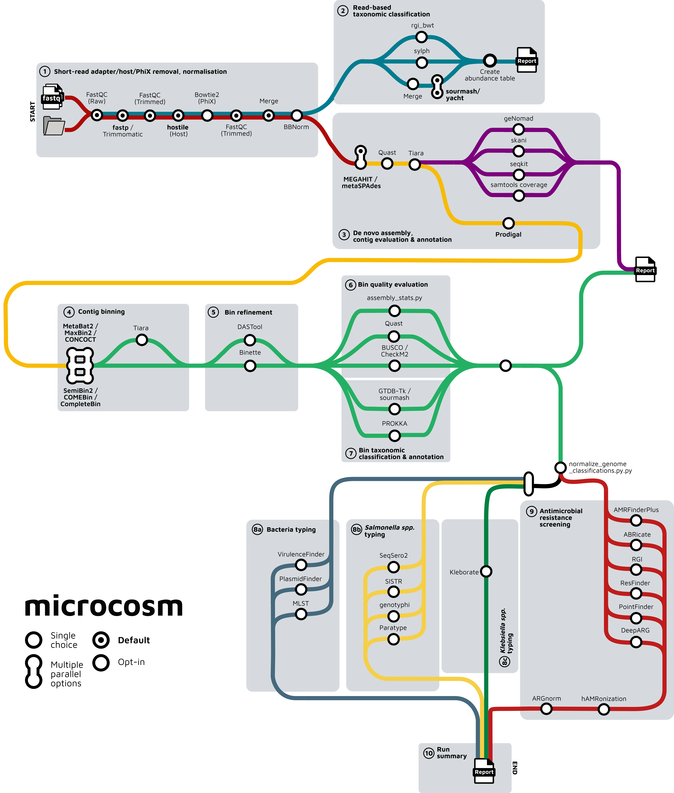

# Roadmap

## Workflow Overview

**Note:** The workflow diagram below outlines features and modules that are *planned* for future upgrades. Some components shown may not be available in the current release.

  

## Development Roadmap

### Done in 2.0.0

- **Export to [`phyloseq`](https://joey711.github.io/phyloseq/) format** (`--readbased_postprocess phyloseq`), also for sylph profiles.
- **AMR screening from MAGs** and from standalone genomes (`--enable_bacterial_downstream`, `--genome_input`).
- **Bacterial typing:** general typing, *Klebsiella* (Kleborate) and *Salmonella* (SISTR, SeqSero2, GenoTyphi, Paratype); each tool can be skipped.
- **sylph** read-based profiling and the **GTDB-Tk** bin classifier.
- One **MultiQC** report per run.

### Planned

- **Plasmid Recovery:**
  Develop tools for identifying and recovering plasmid sequences from metagenomic data (plasmid contigs are already flagged by geNomad).

- **More species-specific typing:**
  e.g. *Enterobacter* and other priority pathogens.

- **Long-read Metagenome Support:**
  Extend pipeline compatibility to handle long-read sequencing data, broadening the range of supported technologies.

- **Read preprocessing:** PhiX removal and depth normalization (BBNorm).

If you have suggestions or specific needs, please reach out or contribute via GitHub. Our goal is to make **microcosm** as user-friendly and versatile as possible.
